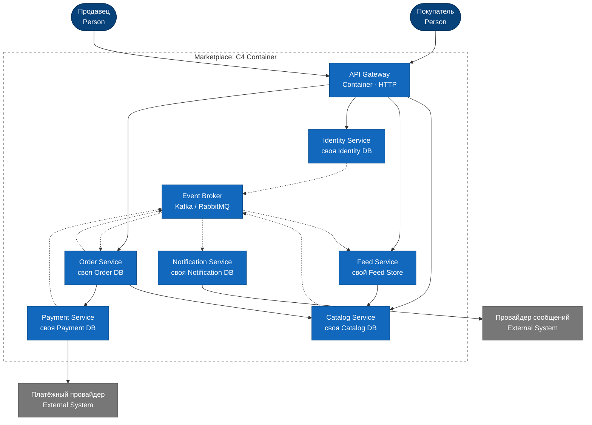

# Архитектура маркетплейса

## Запуск

Требования: Docker и Docker Compose

```bash
docker compose up --build -d
curl -i http://localhost:8080/health
```

Сервис должен ответить со статусом `200 OK`:

```json
{"status":"ok","service":"feed-service"}
```

## C4 Container

Диаграмма: [`docs/c4-container.mmd`](docs/c4-container.mmd) (схема составлена ЛЛМ на основе рисунка)



Сплошные стрелки показывают синхронные вызовы, а пунктирные показывают асинхронные события. Протоколы и названия событий перечислены в таблице ниже.

## Домены

| Домен / сервис | Что делает и какими данными владеет                                                                                |
| -------------- | ------------------------------------------------------------------------------------------------------------------ |
| Identity       | Управляет аккаунтами, ролями покупателя и продавца, а также аутентификацией. Хранит пользователей и учётные данные |
| Catalog        | Управляет карточками, категориями, ценами и остатками. Хранит товары и их связь с продавцом                        |
| Feed           | Формирует персональную выдачу. Хранит интересы, сигналы поведения и готовые списки ID товаров                      |
| Order          | Оформляет заказы и меняет их статусы. Хранит позиции и снимки цен на момент покупки                                |
| Payment        | Рассчитывает сумму к оплате и учитывает платежи. Хранит платёжные попытки, статусы и ID провайдера                 |
| Notification   | Отправляет уведомления о заказах. Хранит шаблоны, сообщения и статусы доставки                                     |

API Gateway только проверяет токен и маршрутизирует запросы. Брокер сообщений для асинхронных событий.

Каждый сервис сам владеет своими данными и использует отдельное логическое хранилище. Общих баз и прямого доступа к чужим таблицам нет. Другие сервисы получают нужные данные через API или события. Цена сохраняется в заказе на момент покупки, поэтому изменения в каталоге не влияют на историю заказов.

### Персонализация

`Feed Service` формирует профиль интересов по категориям и продавцам на основе просмотров и завершённых покупок. При ранжировании учитываются интересы пользователя, популярность и свежесть товаров. Новому пользователю показываются популярные товары. Feed хранит только ID товаров из подборки, а актуальную цену и доступность получает из Catalog.

## Взаимодействия

| Откуда → куда                       | Назначение                          | Тип                                           |
| ----------------------------------- | ----------------------------------- | --------------------------------------------- |
| UI → Gateway → сервисы              | Пользовательские запросы и команды  | Синхронно, HTTPS/JSON                         |
| Feed → Catalog                      | Актуальные данные товаров           | Синхронно, HTTP/JSON                          |
| Order → Catalog                     | Проверка цены, доступности и резерв | Синхронно, HTTP/JSON                          |
| Order → Payment                     | Создание платежа                    | Синхронно, HTTP/JSON с ключом идемпотентности |
| Payment → платёжный провайдер       | Проведение платежа и обратный вызов | Синхронно, HTTPS                              |
| Identity → Broker → Feed            | `UserUpdated`                       | Асинхронно                                    |
| Catalog → Broker → Feed             | `ProductChanged`                    | Асинхронно                                    |
| Payment → Broker → Order            | `PaymentStatusChanged`              | Асинхронно                                    |
| Order → Broker → Notification, Feed | `OrderStatusChanged`                | Асинхронно                                    |

Событие может прийти повторно, поэтому его повторная обработка не должна менять результат. Для надёжной публикации используется паттерн transactional outbox. Order Service поэтапно управляет оформлением заказа. Если оплата не прошла, он освобождает резерв обратной операцией.

## Варианты декомпозиции

### 1. Модульный монолит

Все домены находятся в одном приложении и одной PostgreSQL с отдельными схемами.

- Плюсы: быстрый старт, простые транзакции, низкая стоимость эксплуатации.
- Минусы: единое масштабирование и развёртывание, общая зона отказа, границы модулей легко нарушить.

### 2. Микросервисы адекватного размера (выбранный вариант)

Шесть сервисов, отдельное хранилище на сервис, HTTP API и брокер событий.

- Плюсы: явное владение данными, независимое масштабирование и изоляция сбоев.
- Минусы: данные между сервисами обновляются не мгновенно, появляется несколько баз, а тестирование и эксплуатация усложняются.

### 3. Больше маленьких микросервисов

Catalog делится на Product, Price и Inventory. Order делится на Cart, Checkout и Order, а Feed на Candidate Generation и Ranking.

- Плюсы: точное независимое масштабирование и маленькие зоны отказа.
- Минусы: много сетевых вызовов и контрактов, сложная согласованность, избыточность для стартового этапа.

## Почему выбран второй вариант

Доменные сервисы соответствуют функциям кейса и позволяют независимо масштабировать каталог, ленту, заказы, платежи и уведомления. При этом границы остаются достаточно крупными и не создают чрезмерного количества сетевых вызовов, как в третьем варианте. По сравнению с монолитом решение сложнее, но лучше фиксирует владение данными и изолирует сбои.

Ключевые решения: отдельная база для каждого сервиса, синхронные вызовы только там, где ответ нужен сразу, и события для фоновых действий. Order управляет процессом оформления заказа, а Catalog остаётся единственным источником информации о товаре.

## Структура

```text
cmd/feed-service/main.go       # точка входа
internal/httpapi/              # health handler и тесты
docs/c4-container.mmd          # C4 Container
Dockerfile                     # multi-stage, запуск non-root
compose.yaml                   # запуск и healthcheck
```
