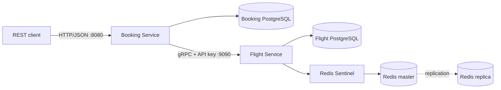

# Flight Booking

## Запуск

Нужны Docker и Docker Compose.

```bash
docker compose up --build -d
curl -i http://localhost:8080/health
```

Ожидаемый ответ:

```json
{"status":"ok","service":"booking-service"}
```

Миграции обеих БД применяются Flyway при старте. В Flight DB автоматически добавляются три тестовых рейса. Полный сценарий поиска, создания и отмены бронирования:

```bash
make demo
```

## Интерактивная проверка API

После запуска Swagger UI доступен по адресу:

```text
http://localhost:8080/swagger-ui.html
```

Остановить сервисы: `docker compose down`. Удалить также данные PostgreSQL и Redis: `docker compose down -v`.

## Архитектура



У сервисов нет общей БД. Поля `flight_id` и `booking_id` между сервисами являются внешними идентификаторами, а не межбазовыми foreign key. ER-диаграмма в 3NF: [`docs/er-diagram.mmd`](docs/er-diagram.mmd).

## REST API

| Метод | Endpoint | Назначение |
|---|---|---|
| GET | `/flights?origin=SVO&destination=LED&date=2026-04-01` | Поиск SCHEDULED-рейсов; `date` необязателен |
| GET | `/flights/{id}` | Получение рейса |
| POST | `/bookings` | Создание бронирования |
| GET | `/bookings/{id}` | Получение бронирования |
| GET | `/bookings?user_id={uuid}` | Бронирования пользователя |
| POST | `/bookings/{id}/cancel` | Отмена и возврат мест |

Пример тела создания:

```json
{
  "user_id": "aaaaaaaa-aaaa-aaaa-aaaa-aaaaaaaaaaaa",
  "flight_id": "11111111-1111-1111-1111-111111111111",
  "passenger_name": "Ivan Petrov",
  "passenger_email": "ivan@example.com",
  "seat_count": 2
}
```

REST-ошибки имеют единый формат `code`, `message`, `details`, `timestamp`. gRPC-коды переводятся в HTTP: `NOT_FOUND` → 404, `INVALID_ARGUMENT` → 400, `RESOURCE_EXHAUSTED` → 409, `UNAVAILABLE` и `DEADLINE_EXCEEDED` → 503.

## gRPC-контракт

Источник контракта: [`flight-contract/src/main/proto/flight_service.proto`](flight-contract/src/main/proto/flight_service.proto). Java-классы и stubs генерируются `protoc` во время Maven-сборки, сгенерированный код в Git не хранится.

Методы отражают бизнес-операции: `SearchFlights`, `GetFlight`, `ReserveSeats`, `ReleaseReservation`, а также `UpdateFlight` для изменения цены/статуса и проверки инвалидации кеша. Контракт использует `Timestamp`, `FlightStatus` и `ReservationStatus`; ожидаемые error codes описаны рядом с RPC.

Вызвать метод напрямую можно через `grpcurl`:

```bash
grpcurl -plaintext \
  -H 'x-api-key: development-secret' \
  -import-path flight-contract/src/main/proto \
  -proto flight_service.proto \
  -d '{"flight_id":"11111111-1111-1111-1111-111111111111"}' \
  localhost:9090 flight.v1.FlightService/GetFlight
```

Без корректного `x-api-key` любой RPC завершается `UNAUTHENTICATED`. Ключ задаётся переменной `FLIGHT_GRPC_API_KEY` в обоих контейнерах.

## Транзакции и конкурентный доступ

`ReserveSeats` блокирует строку рейса через `SELECT FOR UPDATE`, проверяет остаток, уменьшает `available_seats` и создаёт `seat_reservations` в одной транзакции. Уникальный `booking_id` и проверка параметров делают повторный запрос идемпотентным. Это важно, если Booking Service не получил ответ и повторил мутирующий RPC.

`ReleaseReservation` блокирует резервацию, возвращает места и меняет статус на `RELEASED` в одной транзакции. Повторный release не возвращает места второй раз. Ограничения PostgreSQL запрещают отрицательный остаток, неположительные цену/число мест, неверные статусы, одинаковые аэропорты и повтор номера рейса в одну дату.

Booking Service создаёт локальную запись только после успешного `GetFlight` и `ReserveSeats`. `total_price` фиксируется как `seat_count * flight.price`; лишнее производное поле с ценой места в Booking DB не хранится. Если запись в Booking DB не удалась после удалённого резерва, выполняется компенсирующий `ReleaseReservation`.

## Redis и инвалидация

Flight Service использует cache-aside:

| Данные | Ключ | TTL по умолчанию |
|---|---|---|
| Рейс | `flight:{id}` | 10 минут |
| Поиск | `search:{origin}:{destination}:{date|all}` | 10 минут |
| Индекс поисковых ключей рейса | `flight-search-keys:{id}` | 10 минут |

В логах видны `cache hit` и `cache miss`. `ReserveSeats`, `ReleaseReservation` и `UpdateFlight` удаляют карточку рейса и все поисковые выдачи, в которые он входил. Ошибка Redis не ломает основной сценарий: запрос обслуживается из PostgreSQL.

Redis работает как master + replica + Sentinel, а приложение подключается по имени мастера `mymaster`, то есть использует Sentinel-aware Lettuce client. Проверка:

```bash
docker compose exec redis-sentinel redis-cli -p 26379 sentinel get-master-addr-by-name mymaster
docker compose exec redis-replica redis-cli info replication
```

## Retry и circuit breaker

Booking Service делает не более трёх попыток с exponential backoff 100 ms, 200 ms. Повторяются только `UNAVAILABLE` и `DEADLINE_EXCEEDED`; бизнес-ошибки не повторяются. Каждый вызов имеет deadline 2 секунды.

Circuit breaker реализован gRPC client interceptor, поэтому бизнес-сервис о его состояниях не знает. По умолчанию пять инфраструктурных ошибок в окне из десяти вызовов переводят его `CLOSED → OPEN`. Через 15 секунд один запрос проходит в `HALF_OPEN`; успех закрывает breaker, ошибка снова открывает. Переходы пишутся в лог. В `OPEN` реального RPC нет, REST-клиент сразу получает 503 и код `FLIGHT_SERVICE_CIRCUIT_OPEN`.

Проверить можно так:

```bash
docker compose stop flight-service
for i in 1 2 3 4 5 6; do
  curl -s -o /dev/null -w '%{http_code}\n' \
    http://localhost:8080/flights/11111111-1111-1111-1111-111111111111
done
docker compose logs booking-service | grep 'circuit breaker transition'
docker compose start flight-service
```

## Настройки отказоустойчивости

| Переменная | Значение по умолчанию |
|---|---|
| `GRPC_RETRY_MAX_ATTEMPTS` | `3` (значения больше 3 запрещены) |
| `GRPC_RETRY_INITIAL_BACKOFF` | `100ms` |
| `FLIGHT_GRPC_DEADLINE` | `2s` |
| `CB_FAILURE_THRESHOLD` | `5` |
| `CB_WINDOW_SIZE` | `10` |
| `CB_OPEN_TIMEOUT` | `15s` |
| `FLIGHT_CACHE_TTL` | `10m` |
| `FLIGHT_GRPC_API_KEY` | `development-secret` только для локального запуска |

## Соответствие критериям

| Балл | Реализация |
|---|---|
| 1 | Собственный proto, protoc-кодогенерация, Timestamp, enum и gRPC error codes |
| 2 | ER в 3NF, отдельные схемы и CHECK/UNIQUE/FK ограничения |
| 3 | Два PostgreSQL, Flyway, REST Booking Service и gRPC Flight Service |
| 4 | `GetFlight → ReserveSeats → snapshot цены → INSERT booking`; release при отмене |
| 5 | Транзакции и pessimistic row locks для reserve/release |
| 6 | API key в gRPC metadata и глобальный server interceptor |
| 7 | Redis cache-aside, TTL, hit/miss и инвалидация мутаций |
| 8 | До трёх попыток, exponential backoff, фильтр кодов, идемпотентный reserve |
| 9 | Redis master + replica + Sentinel, Sentinel-aware client |
| 10 | Настраиваемый circuit breaker как gRPC interceptor и быстрый HTTP 503 |

## Структура

```text
flight-contract/                         .proto и protoc-кодогенерация
flight-service/                          gRPC, Flight DB, транзакции, Redis
booking-service/                         REST, Booking DB, gRPC client
requests.http                            готовые HTTP-запросы для ручной проверки
*/src/main/resources/db/migration/       миграции Flyway
docs/er-diagram.mmd                      ER-диаграмма в 3NF
redis/sentinel.conf                      конфигурация Sentinel
compose.yaml                             вся инфраструктура и сервисы
scripts/demo.sh                          E2E-сценарий для защиты
```
