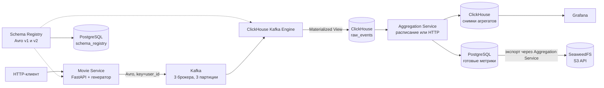
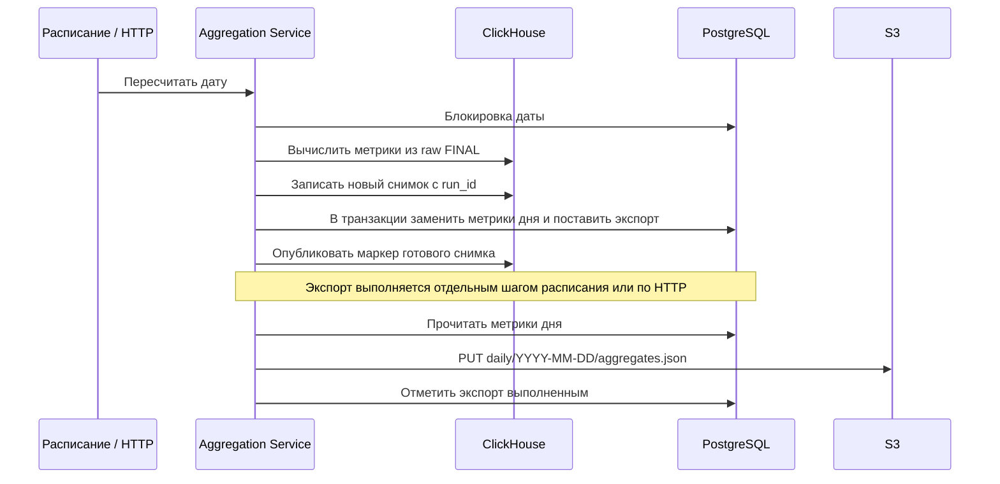

# Online Cinema: Kafka + ClickHouse

События просмотров попадают в Kafka, затем в ClickHouse. Отдельный сервис считает метрики, сохраняет их в ClickHouse и PostgreSQL и выгружает в S3. Grafana читает готовые агрегаты из ClickHouse.

## Запуск и проверка

Нужны Docker Compose и около 6 ГБ свободной RAM.

```bash
cd DZ5
make up
```

Все компоненты запускаются вместе. `Ctrl+C` останавливает весь стек. `make down` удаляет контейнеры и освобождает порты, сохраняя данные. Автозапуск при перезапуске Docker отключён.

`make up` продолжает показывать логи после запуска. Готовность проверяется командой `docker compose ps`: у сервисов должен быть статус `healthy`, у `init` и `registry-db-init` ожидается `Exited (0)`.

Топик, версии Avro, миграции, бакет и дашборд создаются автоматически. Генератор заполняет историю за десять дней и продолжает отправлять новые сессии. Агрегация запускается раз в минуту, поэтому первые графики появляются не сразу.

| Что открыть | Адрес |
| --- | --- |
| Swagger продюсера | http://localhost:8080/docs |
| Swagger агрегации | http://localhost:8082/docs |
| Grafana | http://localhost:3000/d/cinema-analytics, логин `admin`, пароль `adminadmin` |
| Schema Registry | http://localhost:8081/apis/ccompat/v7/subjects/movie-events-value/versions |
| Файлы S3 через интерфейс SeaweedFS | http://localhost:8888/buckets/movie-analytics/ |

Примеры запросов: [requests.http](requests.http). Тесты с запуском всего стека:

```bash
make test
```

После тестов весь стек автоматически выключается, в том числе при ошибке. Повторный запуск создаёт свои ID пользователей и событий. Проверяются путь HTTP → Kafka → ClickHouse, поля события, дедупликация, расчёт метрик, повторный пересчёт, экспорт и настройки Grafana.

Проверка с остановкой одного Kafka-брокера, после которой весь стек тоже выключается:

```bash
make resilience
```

## Архитектура



Продюсер отвечает за валидацию и публикацию. ClickHouse сам потребляет Kafka, дополнительный consumer-сервис не нужен. Aggregation Service читает только ClickHouse и не участвует в приёме событий.

## Принятые решения

| Решение | Почему |
| --- | --- |
| Ключ Kafka `user_id` | События пользователя попадают в одну партицию. Это сохраняет порядок записи его сессий и подходит для retention. Ключ `movie_id` мог бы перегрузить партицию популярного фильма |
| Avro + Schema Registry | В сообщении передаются бинарные данные и ID схемы. ClickHouse загружает схему из Registry и проверяет типы |
| Apicurio Registry | Совместим с Confluent API, хранит схемы в отдельной БД PostgreSQL. Не требует большого образа Confluent Platform |
| Две версии схемы | v2 добавляет nullable `search_query` с `default: null`. Политика `BACKWARD_TRANSITIVE` проверяет совместимость со всеми предыдущими версиями |
| Три брокера KRaft | Три копии топика, `min.insync.replicas=2`, `acks=all`. После отказа одного брокера остаются две реплики и большинство контроллеров |
| Идемпотентный Kafka producer | Убирает дубли сетевых повторов внутри сессии продюсера. Повторный HTTP-запрос дополнительно учитывается через `event_id` при расчёте метрик |
| ReplacingMergeTree + `FINAL` | Kafka Engine может доставить запись повторно. `FINAL` удаляет повторы до вычислений, даже если фоновые слияния ещё не прошли |
| Месячные партиции, сортировка по дню, пользователю и событию | Удобны выборки за день и удаление истории по месяцам. `event_id` входит в ключ дедупликации |
| Пересчёт снимками | Обычная суммирующая materialized view учла бы повторную доставку как новое событие. Полный пересчёт дня проще сделать идемпотентным |
| PostgreSQL для готовых метрик | Уникальный ключ `(дата, метрика, измерение)` и транзакционная замена дня. Другим сервисам не приходится сканировать raw-события |
| SeaweedFS для S3 | S3-совместимое хранилище с постоянным томом. Экспорт использует обычный boto3 и может работать с другим S3 endpoint |

SeaweedFS создаёт по одному тому размером до 64 МБ, с лимитом 16 томов на узел. Запас нужен и для данных бакета, и для внутренних журналов filer. Уже существующие тома сохраняются.

Событие с тем же `event_id` должно повторяться без изменения пользователя, времени и содержимого. API проверяет UUID, enum, часовой пояс и неотрицательный прогресс, затем отдельно валидирует Avro-запись. Межсобытийный порядок внешнего клиента API не проверяет. Генератор сам создаёт корректные сессии: начало, пауза, продолжение, завершение. Публикация повторяется средствами Kafka-клиента с растущей задержкой; ответ `201` возвращается после подтверждения брокера. При неопределённом исходе клиент повторяет запрос с тем же ID.

## Как считаются метрики

Граница дня определяется по времени события в UTC, а не по времени получения. Все расчёты выполняются SQL-запросами в [app/queries.py](app/queries.py).

| Метрика | Определение |
| --- | --- |
| DAU | `uniqExact(user_id)` по всем событиям дня |
| Среднее время просмотра | Сумма `progress_seconds` завершённых просмотров, делённая на их число |
| Топ фильмов | Число `VIEW_STARTED` по `movie_id` |
| Конверсия | `VIEW_FINISHED / VIEW_STARTED` в пределах дня, как требует задание |
| Retention D1/D7 | Пользователи когорты с любой активностью через 1/7 дней, делённые на размер когорты |
| Когорта | Дата первого `VIEW_STARTED` пользователя во всей доступной истории |

Когортный запрос сначала находит первый просмотр через `min`, собирает дни активности через `groupUniqArray`, затем считает возвраты для Day 0-7. Будущие дни содержат `null`, а не нулевой retention. Данные текущего дня предварительные. Если знаменатель отсутствует, конверсия, среднее и retention равны `null`.

Конверсия здесь событийная, а не сессионная. Завершения могут относиться к просмотрам, начатым вчера, поэтому дневное отношение иногда превышает 100%. Для продуктовой конверсии сессий понадобилась бы привязка завершения к началу.

Grafana показывает таблицу когорт с цветными ячейками, DAU, конверсию, топ фильмов и среднее время просмотра. Панели используют только `cinema.metrics_current`.

## Пересчёт и экспорт



Маркер готовности позволяет Grafana видеть только целые снимки. PostgreSQL заменяет день одной транзакцией, включая удаление исчезнувших строк топа. Блокировка даты через advisory lock защищает от одновременного ручного и планового пересчёта. Экспорт использует ту же блокировку.

Между ClickHouse и PostgreSQL нет общей транзакции: при сбое один из них временно отстаёт. Следующий пересчёт восстанавливает согласованность. Неопубликованные снимки не видны в Grafana.

Расписание пересчитывает сегодня и десять предыдущих дней, чтобы учитывать запоздалые события и созревание D7. Более старую дату можно пересчитать вручную. Если позднее событие изменило дату первого просмотра, нужно пересчитать и старую, и новую дату когорты.

Экспорт берёт данные **из PostgreSQL**. JSON содержит дату, все метрики, измерения, время вычисления и `run_id`. Путь: `s3://movie-analytics/daily/YYYY-MM-DD/aggregates.json`. Повторная выгрузка заменяет объект. Для прошедших дней задание экспорта ставится автоматически после пересчёта, вручную можно выгрузить любую рассчитанную дату. Ошибка оставляет задание в PostgreSQL со статусом `pending`; расписание повторит попытку. Временные ошибки PostgreSQL и S3 дополнительно получают три попытки с задержками 200 и 400 мс.

## Настройки

| Переменная | По умолчанию | Назначение |
| --- | --- | --- |
| `AGGREGATION_INTERVAL_SECONDS` | `60` | Пауза между циклами агрегации |
| `RECOMPUTE_DAYS` | `10` | Сколько предыдущих дней пересчитывать |
| `GENERATE_EVENTS` | `true` | Продолжать генерацию новых сессий |
| `GENERATOR_INTERVAL_SECONDS` | `5` | Пауза между синтетическими сессиями |
| `DEMO_SEED` | `true` | Загружать демонстрационную историю при старте |

Например, `GENERATE_EVENTS=false DEMO_SEED=false make up` запускает pipeline без генератора. API остаётся доступным.

У всех долгоживущих компонентов есть healthcheck. Одноразовый `init` регистрирует схемы, применяет версионированные SQL-миграции и создаёт бакет до старта сервисов. Его успех проверяется через `service_completed_successfully`.

## Ограничения

Отказоустойчивость проверяется для Kafka. ClickHouse, PostgreSQL и S3 здесь одноузловые; это учебный стек. Порядок Kafka соответствует порядку публикации, а не произвольным временным меткам клиента. HTTP-повторы и ingestion имеют семантику at-least-once. Снимки и raw-история автоматически не удаляются. Для большого объёма понадобятся политика хранения, инкрементальное обновление когорт и отказ от полного сканирования истории при каждом расчёте.

Документация: [Kafka Engine и AvroConfluent](https://clickhouse.com/docs/interfaces/formats/AvroConfluent), [настройка Grafana datasource](https://grafana.com/docs/plugins/grafana-clickhouse-datasource/latest/configure/), [SeaweedFS](https://github.com/seaweedfs/seaweedfs).
